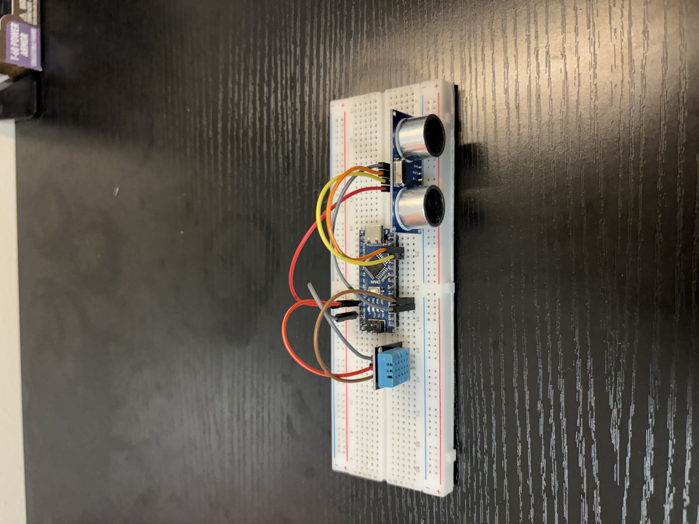
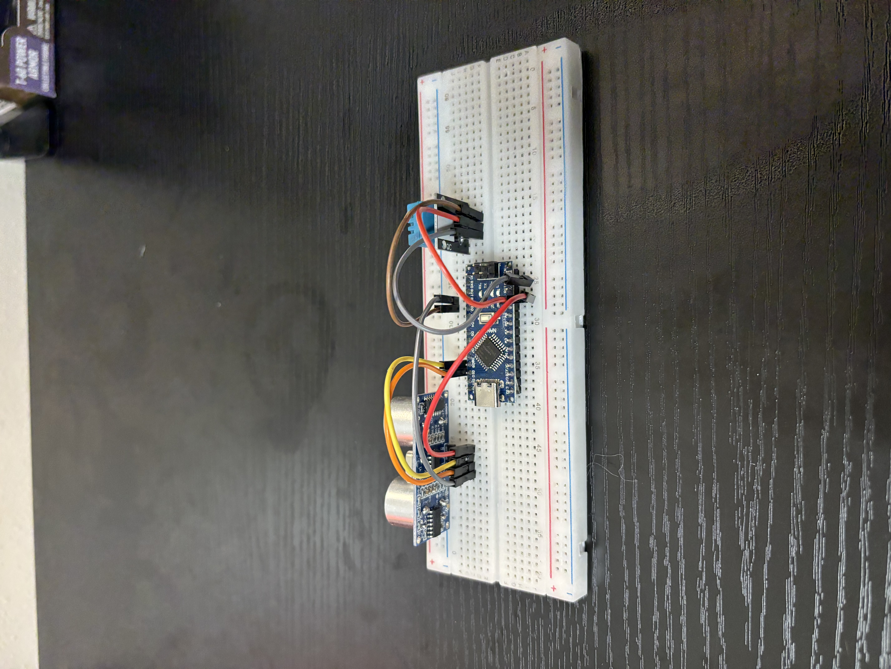
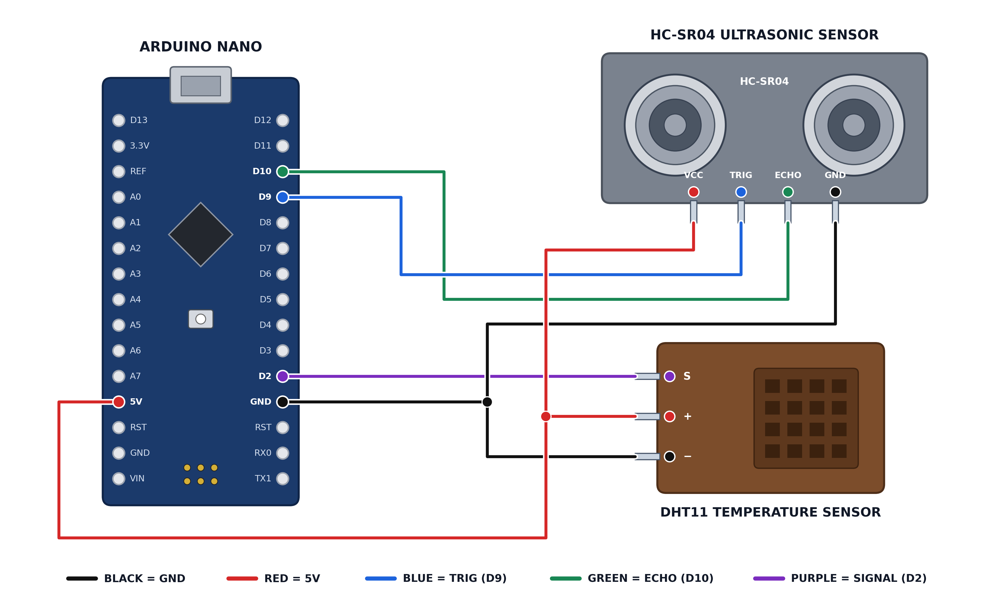

# Ultrasonic Distance Sensor Calibration

## Overview
Cheap ultrasonic sensors like the HC-SR04 usually assume the speed of sound is fixed at **343 m/s**, which ignores real room temperature and small hardware offsets. In this project, I used **Unit 4 Multivariable Calculus**—partial derivatives, total differentials, and the Method of Least Squares—to find the biggest source of error and calibrate an HC-SR04 + DHT11 setup on an Arduino Nano.

After calibrating the firmware, overall distance error dropped by **58.4%** (from **0.81 cm** down to **0.34 cm**) and timing jitter dropped by **65.0%**.

---

## Hardware & Wiring

### Components
* Arduino Nano
* HC-SR04 Ultrasonic Distance Sensor
* DHT11 Temperature & Humidity Sensor (3-pin breakout module)
* Breadboard, jumper wires, metric ruler, and a flat target

### Pin Connections
| Component | Sensor Pin | Arduino Nano Pin |
| :--- | :--- | :--- |
| **HC-SR04** | `VCC` | `5V` |
| **HC-SR04** | `GND` | `GND` |
| **HC-SR04** | `TRIG` | `D9` |
| **HC-SR04** | `ECHO` | `D10` |
| **DHT11 Module** | `S` (Signal) | `D2` |
| **DHT11 Module** | Middle (`+` / VCC) | `5V` |
| **DHT11 Module** | `-` (GND) | `GND` |

---

## The Multivariable Calculus Behind It

### 1. Distance as a Function of Two Variables
The speed of sound changes with air temperature $T$ (in °C):

$$v(T) = 331.3 + 0.606T \text{ m/s}$$

Converting to centimeters and microseconds (and dividing by 2 for the round trip) gives distance as a function of echo time $t$ (in µs) and temperature $T$ (in °C):

$$D(t, T) = \frac{t \cdot (331.3 + 0.606T)}{20000}$$

### 2. Partial Derivatives & Error Analysis
To see whether **timing jitter** or **temperature error** hurts accuracy more, I took both partial derivatives:

$$\frac{\partial D}{\partial t} = \frac{331.3 + 0.606T}{20000} \approx 0.0172 \text{ cm/µs} \quad (\text{at } 21.4^\circ\text{C})$$

$$\frac{\partial D}{\partial T} = \frac{0.606t}{20000} \text{ cm/}^\circ\text{C}$$

Then I plugged my real baseline data into the **Total Differential**:

$$\Delta D \approx \left\vert{}\frac{\partial D}{\partial t}\right\vert{}\Delta t + \left\vert{}\frac{\partial D}{\partial T}\right\vert{}\Delta T$$

* **Indoors ($\Delta T = \pm 2.0^\circ\text{C}$ DHT11 spec):** Timing jitter ($\Delta t$) is the bigger problem. At 30 cm, jitter caused **0.24 cm** of error vs. **0.11 cm** from temperature.
* **Temperature swings ($\Delta T = 10^\circ\text{C}$):** Temperature error jumps to **0.53 cm** at 30 cm and overtakes jitter.
* **Distance trend:** Temperature sensitivity ($\frac{\partial D}{\partial T}$) grows more than **5×** from 10 cm (`0.0163 cm/°C`) to 50 cm (`0.0860 cm/°C`).

### 3. Least-Squares Calibration
Even after compensating for room temperature (`21.4 °C`), the sensor still read short by about `0.7–1.1 cm`. Using the **Method of Least Squares** (minimizing the Sum of Squared Errors by setting $\frac{\partial S}{\partial m} = 0$ and $\frac{\partial S}{\partial b} = 0$), I fit a linear correction to match the true ruler distances:

$$D_{\text{cal}} = 1.0070 \cdot D(t, T) + 0.4421$$

---

## Calibration Changes in C++
Based on the math above, I upgraded `firmware/calibrated/calibrated.ino` with three fixes:
1. **5-ping median filter** to cut down timing jitter ($\Delta t$).
2. **Live DHT11 temperature compensation** using $D(t, T)$.
3. **Least-squares calibration** applying $m = 1.0070$ and $b = 0.4421\text{ cm}$.

---

## Results (Before vs. After)
Each distance was tested with 5 trials against a metric ruler at **21.4 °C**:

| True Dist (cm) | Before Avg (cm) | Before MAE (cm) | After Avg (cm) | After MAE (cm) | Jitter $\Delta t$: Before → After (µs) |
| :---: | :---: | :---: | :---: | :---: | :---: |
| **10** | 9.25 | 0.75 | 9.38 | 0.62 | 19.5 → 3.0 |
| **20** | 19.12 | 0.88 | 19.76 | 0.24 | 1.5 → 0.5 |
| **30** | 30.07 | 0.19 | 30.46 | 0.46 | 14.0 → 10.5 |
| **40** | 39.09 | 0.91 | 39.84 | 0.19 | 9.5 → 9.5 |
| **50** | 48.69 | 1.31 | 49.83 | 0.17 | 25.5 → 1.0 |
| **Overall** | — | **0.81 cm** | — | **0.34 cm** | **14.0 → 4.9 µs** |

### Key Takeaways
* **58.4% less error overall:** Mean Absolute Error fell from **0.81 cm** to **0.34 cm**, right near the HC-SR04's rated **0.3 cm** hardware limit.
* **65.0% less jitter:** The 5-ping median filter cut average half-spread timing jitter from **14.0 µs